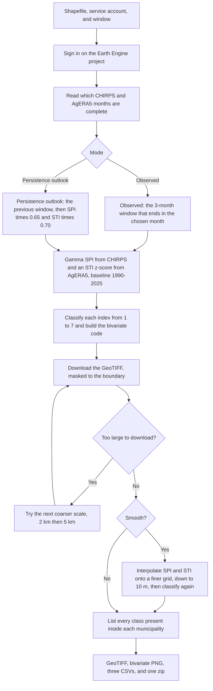
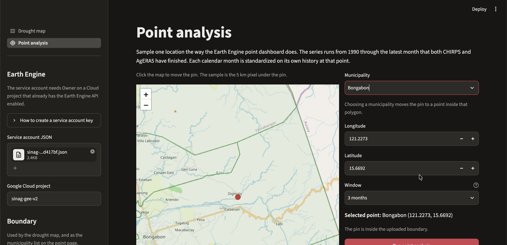
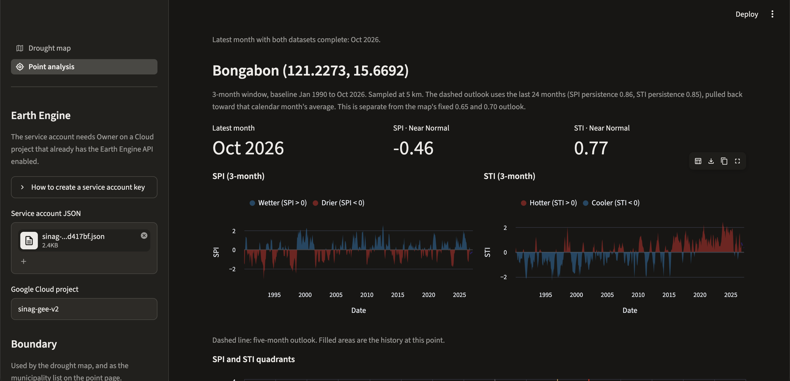
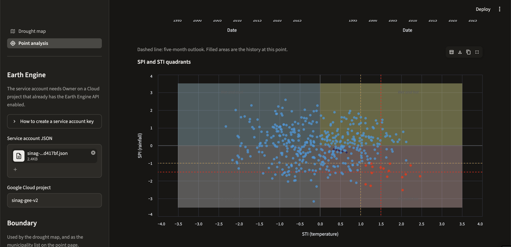
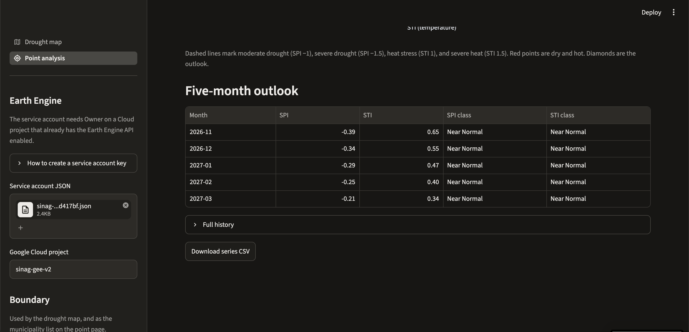
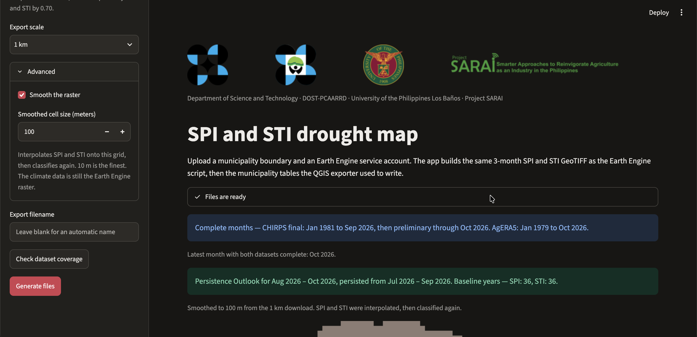
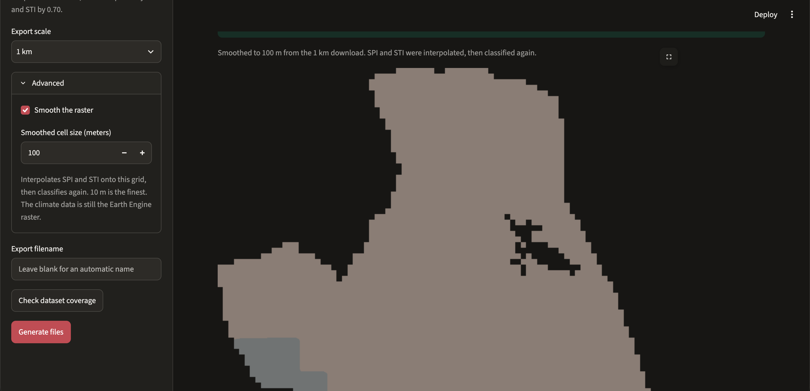
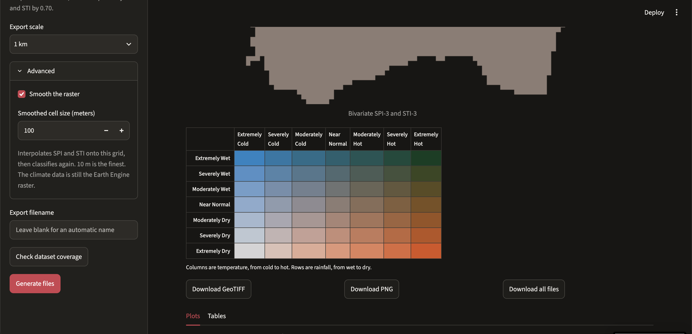
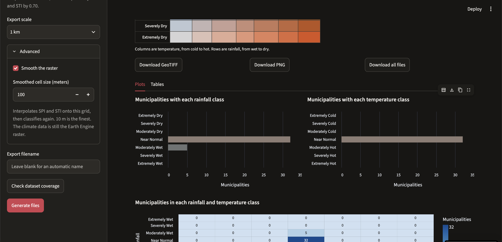
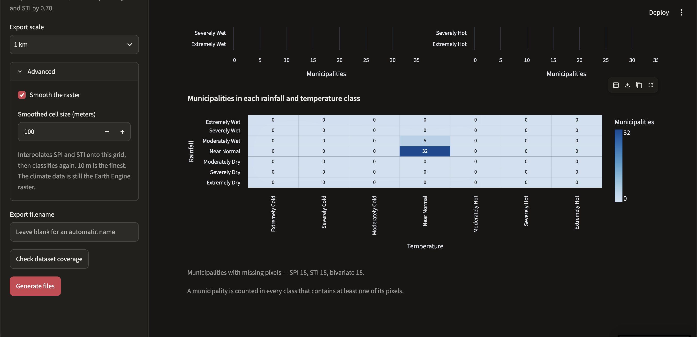

# SPI and STI drought map


Department of Science and Technology · DOST-PCAARRD · University of the Philippines Los Baños · Project SARAI

A Streamlit app for the SARAI community-level drought tool. It has two pages. **Drought map** writes the files the old two-step process produced: the multi-band GeoTIFF from the Earth Engine app, and the three municipality tables from the QGIS script. **Point analysis** is the Earth Engine point dashboard: one location, a SPI and STI time series, and a five-month outlook.

The same key steps below are also in the sidebar, under **How to create a service account key**.

## How the process works

The old path was an Earth Engine app, then a QGIS script. The drought map page keeps both steps and runs them in order. Point analysis is a separate page and does not write a raster.



**Check dataset coverage** stops after the complete-months step. **Generate files** runs the rest. If a season has fewer than 10 baseline years, the map is refused before the download. At 5 km, a download that is still too large stops with the Earth Engine error instead of trying again. Smoothing is optional. It does not fetch a finer climate grid. It interpolates the downloaded SPI and STI, then classifies that finer grid. 10 m is the finest cell.

## Point analysis

Open **Point analysis** in the sidebar. Click the map, type a longitude and latitude, or choose a municipality from the boundary uploaded on the left. The pin starts near Los Baños.

These shots are Bongabon, a 3-month window, sampled at 5 km. The baseline is January 1990 through October 2026.

The municipality list moves the pin to a point inside that polygon.



**Run point analysis** reads every complete month that CHIRPS and AgERA5 share from 1990, at the 5 km pixel under the pin. Rainfall is summed over the window you pick (1, 3, 6, 9, or 12 months). Temperature is averaged. Each calendar month is then standardized on its own history at that point. Changing the window reuses those months. A new location asks Earth Engine again.

SPI is the same gamma index as the map. STI is a z-score. The baseline here is the whole series at the point, not the map's one season across 1990–2025.

October 2026 is near normal for both indices: SPI −0.46 and STI 0.77. Wetter months are blue on the SPI chart. Hotter months are red on the STI chart.



The quadrant plot puts every month on SPI against STI. Red points are compound dry and hot: SPI at or below −1 and STI at or above 1.



The dashed line on the time series, and the diamonds on the quadrant plot, are five months ahead. Each step uses the lag-1 correlation of the last 24 months, held between 0 and 0.9, and pulls back toward that calendar month's average. It is not the map's fixed 0.65 and 0.70 persistence outlook.

The outlook table runs November 2026 through March 2027. This location stays near normal. **Full history** opens the sampled months, and **Download series CSV** saves the history and the outlook together.



## The drought map page

These shots are one persistence outlook, August–October 2026, smoothed from the 1 km download to 100 m.

The run lists the complete months, then the window and the baseline years.



The bivariate map is masked to the uploaded boundary.



The 49-color legend sits under the map. GeoTIFF, PNG, and the full zip download from the same place.



**Plots** counts municipalities in each rainfall class and each temperature class.



The heatmap is that same count for every rainfall and temperature pair. The municipality names are on the **Tables** tab.



## Setup

```bash
python -m venv .venv
source .venv/bin/activate
pip install -r requirements.txt
streamlit run app.py
```

## How to create a service account key

Use this when your Google account already has Earth Engine, and the Cloud project already has the Earth Engine API enabled. The service account still has to be **Owner** on that project. Upload the JSON key in the sidebar. The app keeps it in memory for the session and does not write it into this folder. Do not commit the key.

1. In the Google Cloud console, open the [Service accounts](https://console.cloud.google.com/iam-admin/serviceaccounts) page and select the project that already has Earth Engine.
2. If that project has no service account yet, create one and grant it the Owner role (`roles/owner`).
3. Click the service account's email address.
4. Open the **Keys** tab.
5. Click **Add key**, then **Create new key**.
6. Select **JSON** and click **Create**.

The browser downloads the key file. Google will not let you download that same key again. If Earth Engine rejects the key in the first minute after you create it, wait and try once more. The project id is the `project_id` field in the file. Change it in the sidebar only if Earth Engine is enabled on a different project.

The same console steps, plus the gcloud and API versions, are in Google's guide: [Create and delete service account keys](https://docs.cloud.google.com/iam/docs/keys-create-delete). If **Create new key** is missing or refused, that page also covers the organization policy that can block new keys (`iam.disableServiceAccountKeyCreation`).

SINAG's own walkthrough is [Configure Google Earth Engine API and service key](https://dostsinag.com/documentation/guides/gee-service-key/). After the JSON downloads, register its `client_email` on the [Earth Engine service accounts](https://signup.earthengine.google.com/#!/service_accounts) page, signed in with the Google account that already has Earth Engine.

## Data the account has to read

Two collections are Climate Engine assets. The service account needs to be able to read them:

- `projects/climate-engine-pro/assets/ce-chirps-prelim-pentad`
- `projects/climate-engine-pro/assets/ce-ag-era5-v2/daily`

CHIRPS final pentads are the public collection `UCSB-CHC/CHIRPS/V3/PENTAD`. If the preliminary series does not connect to the final series, the app ignores it, the same way the Earth Engine script does.

## What you set

- **Shapefile zip.** One shapefile, including `.shp`, `.shx`, `.dbf`, and `.prj`. It is reprojected to longitude and latitude.
- **Municipality name field.** `Mun_Name` when that column exists. Otherwise the first text field whose name looks like a municipality, matching the QGIS script (`NAME_2`, `ADM3_EN`, and similar).
- **Check dataset coverage.** Asks Earth Engine which months of CHIRPS and AgERA5 are complete, before a map is built.
- **Analysis mode.** Observed is the 3-month window that ends in the month you pick. Persistence outlook uses the previous window, then multiplies SPI by 0.65 and STI by 0.70.
- **Export scale.** Starts at the scale you pick, 1 km, 2 km, or 5 km, and steps coarser if Earth Engine refuses the download as too large.
- **Smooth the raster.** Under Advanced. Interpolates SPI and STI onto a cell you choose, from 1 km down to 10 m, then classifies again. The GeoTIFF stays in EPSG:4326. A boundary that would make more than about 40 million cells is refused, and the message names the finest cell that still fits.
- **Export filename.** Leave it blank and the app names the file from the mode and the window.

The baseline is 1990–2025. The map is refused below 10 years for that season, and the page warns you below 20.

## Files

After **Generate files** the page plots how many municipalities fall in each SPI class, each STI class, and each cell of the bivariate matrix. The municipality names stay on the **Tables** tab. You can download the GeoTIFF, the PNG, each CSV, or one zip of all of them.

- GeoTIFF bands: `SPI3`, `STI3`, `SPI_Class`, `STI_Class`, `Bivariate_Code`. Classes run from 1 to 7. The bivariate code is `STI class × 10 + SPI class`. Masked to the boundary, EPSG:4326.
- A PNG of the bivariate band, with the same 49 colors as the Earth Engine app.
- `{layer}_SPI_STI_Bivariate_Matrix.csv`
- `{layer}_SPI_Summary.csv`
- `{layer}_STI_Summary.csv`

A municipality is listed under every class that has at least one pixel inside it. The same municipality can appear in more than one class. That is what the QGIS zonal histogram was doing.

SPI classes, from the driest: extremely dry, severely dry, moderately dry, near normal, moderately wet, severely wet, extremely wet. Breaks are ≤ −2, ≤ −1.5, ≤ −1, the middle, ≥ 1, ≥ 1.5, ≥ 2.

STI uses those same breaks, from extremely cold to extremely hot. SPI is a gamma index (Thom's maximum-likelihood fit on the non-zero 3-month totals, then the normal quantile). STI is a z-score of the 3-month mean temperature.

## Where the code lives

- `app.py` is the shared header, the Earth Engine sign-in, the boundary upload, and the page list.
- `spi_sti/pages/map_page.py` is the drought map.
- `spi_sti/pages/point_page.py` is the point analysis page.
- `spi_sti/ui.py` is the header and the shared sidebar.
- `spi_sti/auth.py` signs in with the service account.
- `spi_sti/indices.py` builds the SPI and STI raster on Earth Engine and downloads it.
- `spi_sti/point.py` samples one location and computes its SPI and STI series.
- `spi_sti/zonal.py` reads the shapefile and writes the municipality tables.
- `spi_sti/style.py` holds the class labels, the bivariate colors, and the PNG.
- `spi_sti/charts.py` draws the municipality charts and the point charts.
- `statics/` holds the DOST, DOST-PCAARRD, UPLB, and Project SARAI marks.
- `docs/` holds screenshots of a finished map run and a point run.
- `references/gee_script.js` is the original Earth Engine app.
- `references/` holds the QGIS exporter and the SARAI CL-SEAMS guide.

## References

- McKee, T.B., Doesken, N.J., and Kleist, J. (1993). The relationship of drought frequency and duration to time scales. Proceedings of the Eighth Conference on Applied Climatology.
- World Meteorological Organization (2012). Standardized Precipitation Index User Guide (WMO-No. 1090). Geneva.
- Thom, H.C.S. (1958). A note on the gamma distribution. Monthly Weather Review, 86(4), 117–122.
- Funk, C., Peterson, P., Landsfeld, M., Pedreros, D., Verdin, J., Shukla, S., Husak, G., Rowland, J., Harrison, L., Hoell, A., and Michaelsen, J. (2015). The climate hazards infrared precipitation with stations — a new environmental record for monitoring extremes. Scientific Data, 2, 150066. Collection used here: `UCSB-CHC/CHIRPS/V3/PENTAD`.
- Boogaard, H., Schubert, J., De Wit, A., Lazebnik, J., Hutjes, R., and Van der Grijn, G. Agrometeorological indicators from 1979 to present derived from reanalysis (AgERA5). Copernicus Climate Change Service. The app reads Climate Engine's daily 2 m mean air temperature, `projects/climate-engine-pro/assets/ce-ag-era5-v2/daily`, band `Temperature_Air_2m_Mean_24h`.
- Huntington, J.L., Hegewisch, K.C., Daudert, B., Morton, C.G., Abatzoglou, J.T., McEvoy, D.J., and Erickson, T. (2017). Climate Engine: cloud computing and visualization of climate and remote sensing data. Bulletin of the American Meteorological Society. Preliminary CHIRPS pentads: `projects/climate-engine-pro/assets/ce-chirps-prelim-pentad`.
- Google Cloud. [Create and delete service account keys](https://docs.cloud.google.com/iam/docs/keys-create-delete).
- SINAG. [Configure Google Earth Engine API and service key](https://dostsinag.com/documentation/guides/gee-service-key/).
- SARAI CL-SEAMS drought monitoring tool guide: [references/SARAI CL-SEAMS DROUGHT MONITORING TOOL GUIDE.pdf](references/SARAI%20CL-SEAMS%20DROUGHT%20MONITORING%20TOOL%20GUIDE.pdf).
- Earth Engine app this map is taken from: [references/gee_script.js](references/gee_script.js).
- QGIS table exporter this app replaces: [references/Multi-Band-Stylizer-Municipality-Bivariate-Matrix-Exporter-v3.2.py](references/Multi-Band-Stylizer-Municipality-Bivariate-Matrix-Exporter-v3.2.py).
